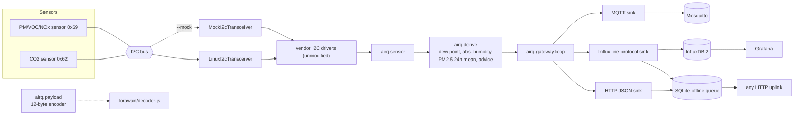

# airq-edge-gateway

A small edge gateway for indoor air quality. It reads a particle / temperature / humidity / VOC / NOx sensor and optionally a CO2 sensor over I2C, works out a few derived values, and ships the result three ways: MQTT, InfluxDB line protocol, and a plain HTTP JSON POST. It runs with no hardware at all through a mock I2C bus.

It is a portfolio / learning project, not a product. See [Limits](#limits--not-verified) before trusting it with anything.


<sub>30 minutes of gateway output from the mock I2C bus (synthetic occupancy wave, not recorded data), with the advice thresholds from `airq/derive.py`.</sub>

## Why

Getting a reading off a sensor is the easy part. The parts that usually go wrong on a small single-board Linux box are the boring ones: the uplink is down for an hour, a line-protocol string is not escaped, a "24 h mean" quietly includes yesterday. This repo tries to get those right and test them.

- It uses the sensors' open-source Python I2C drivers unmodified (see [Dependencies](#dependencies-and-licences)).
- The mock sits at the lowest layer the driver offers, so the real driver code (command building, CRC checking, decoding) runs in every test and demo.
- `lorawan/` has a generic JS uplink decoder (`decodeUplink`, TTN / ChirpStack style) for a compact 12-byte payload.

## Architecture



How the mock works: `I2cConnection` only needs an object with `API_VERSION = 1` and `transceive(address, tx_data, rx_length, read_delay, timeout)`. `airq/mock_i2c.py` implements that. It looks at the 16-bit command, and replies with big-endian words each followed by a CRC-8 (poly `0x31`, init `0xFF`, per 2-byte word; `0xBEEF` gives `0x92`). The driver verifies those CRCs and decodes the values as it would on a real chip. A test flips one CRC bit and checks the driver raises `I2cChecksumError`. The simulated room is a synthetic ~10 minute "occupancy" wave plus noise, not recorded data.

## Quickstart

```bash
python -m venv .venv
.venv/bin/pip install -e ".[dev]"        # Windows: .venv\Scripts\pip

python -m airq run --mock --once                      # one JSON record
python -m airq run --mock --seconds 30                # 30 s, every 5 s
python -m airq run --mock --once --sink influx        # line protocol on stdout
python -m airq run --mock --sink influx --influx-target readings.lp
python -m airq run --mock --sink http --http-url http://localhost:8080/ingest
python -m airq run --mock --sink mqtt --mqtt-host localhost   # needs paho-mqtt
```

On a Pi with the sensor wired: `AIRQ_BACKEND=i2c AIRQ_I2C_DEVICE=/dev/i2c-1 python -m airq run --sink influx ...` (see Limits).

Sinks can be combined (`--sink stdout --sink mqtt`). A sink that throws is logged and does not stop the others. Config also comes from env: `AIRQ_BACKEND`, `AIRQ_INTERVAL`, `AIRQ_DEVICE_ID`, `AIRQ_MQTT_HOST/PORT`, `AIRQ_INFLUX_TARGET/TOKEN`, `AIRQ_HTTP_URL`, `AIRQ_QUEUE_PATH`.

### Sample output (real mock run)

`python -m airq run --mock --once`:

```json
{"ts":1794063642.043,"device":"airq-01","pm1_0":9.6,"pm2_5":13.8,"pm4_0":15.9,"pm10":18.6,"temperature_c":22.5,"humidity_pct":48.78,"voc_index":132.9,"nox_index":1.3,"co2_ppm":1019.0,"dew_point_c":11.19,"abs_humidity_gm3":9.72,"pm2_5_24h_mean":13.8,"advice":["CO2 above 1000 ppm: ventilate"]}
```

`python -m airq run --mock --seconds 10 --interval 5 --sink influx`:

```
airq,device=airq-01 pm1_0=9.6,pm2_5=13.8,pm4_0=15.9,pm10=18.6,temperature_c=22.5,humidity_pct=48.78,voc_index=132.9,nox_index=1.3,co2_ppm=1019.0,dew_point_c=11.19,abs_humidity_gm3=9.72,pm2_5_24h_mean=13.8,advice="CO2 above 1000 ppm: ventilate" 1794063643567000000
airq,device=airq-01 pm1_0=9.6,pm2_5=13.7,pm4_0=15.8,pm10=18.5,temperature_c=22.55,humidity_pct=49.36,voc_index=134.4,nox_index=1.3,co2_ppm=1064.0,dew_point_c=11.41,abs_humidity_gm3=9.87,pm2_5_24h_mean=13.75,advice="CO2 above 1000 ppm: ventilate" 1794063648576000000
```

The same reading as the 12-byte payload (`airq.payload.encode`): `08ca130e03fb008a00ba4201`.

## Derived values

| value | how | notes |
|---|---|---|
| dew point | Magnus formula, a = 17.62, b = 243.12 degC (Sonntag 1990) | tested against hand values |
| absolute humidity | Magnus saturation pressure, ideal gas for vapour | g/m3 |
| PM2.5 24 h mean | time-windowed mean of the samples seen by this process | restarts reset it; it is a mean over what the gateway saw, not a validated 24 h average |
| advice | CO2 > 1000 ppm ventilate, > 1500 ppm ventilate now; PM2.5 24 h mean > 15 ug/m3; RH outside 30-60 %; temperature outside 18-26 C; VOC index > 250 | 1000 / 1500 ppm and the RH/temperature bands are common rules of thumb, not standards claims. 15 ug/m3 is the WHO 2021 24 h guideline value. The advice is a hint, not a safety function. |

## Offline buffer

`http` and HTTP `influx` sinks write every body to a SQLite queue (`AIRQ_QUEUE_PATH`) first, then POST oldest-first with exponential-backoff retries, and delete a row only after a 2xx. If the uplink is down the queue just grows and is drained in order on the next successful cycle, including across restarts. The test starts with a closed port, sends three records, brings a `http.server` up on that port, and checks all four arrive in order.

## LoRaWAN decoder (`lorawan/`)

`decoder.js` decodes the 12-byte payload (layout in `airq/payload.py`) with the `decodeUplink({ bytes })` convention used by The Things Stack and ChirpStack, returning `{ data, warnings, errors }`; unknown values are `null` and a wrong length is reported as an error. `data.schema.json` describes the decoded fields. `node lorawan/test_decoder.js` runs it against the vectors in `lorawan/test_vectors.json`, which are also checked against the Python encoder in pytest, so the two sides cannot drift. I have not run it on a real network server.

## Docker demo

`docker compose up --build` starts the mock gateway, Mosquitto, InfluxDB 2 and Grafana (http://localhost:3000, a provisioned Flux datasource and one dashboard). Credentials in the compose file are throwaway local values.

Compose was run once on Docker Desktop (Windows): all four containers came up, InfluxDB held 8 `co2_ppm` points after about 40 s, a Mosquitto subscriber received the gateway's JSON on `airq/airq-01/state`, and Grafana loaded the dashboard and reported the datasource healthy. I did not inspect the panels visually.

## Tests

```bash
python -m pytest -q
node lorawan/test_decoder.js
PYTHONPATH=. python scripts/make_figures.py      # regenerates docs/figure.png and docs/post-figure.png
```

Covered: CRC-8 vectors (`0xBEEF` -> `0x92`, and agreement with the driver's own `CrcCalculator`), the real vendor driver reading the mock bus (including corrupt-CRC rejection), derive math against hand values, line-protocol escaping, offline queue (down -> queued -> flushed, restart survival, 5xx keeps the item), the gateway loop, the CLI and the payload/decoder vectors.

## Dependencies and licences

This repo is MIT. It depends on, and does not copy, the sensor vendor's open-source Python drivers: `sensirion-i2c-driver` 1.0.2 (BSD-3-Clause), `sensirion-i2c-sen5x` 0.1.1 and `sensirion-i2c-scd` 0.1.2 (both BSD, per PyPI metadata). Optional: `paho-mqtt` (EPL-2.0 / EDL-1.0). No affiliation is implied.

## Limits / not verified

- Never run on real hardware. The `i2c` backend only swaps in the driver library's `LinuxI2cTransceiver`; wiring, bus speed, warm-up timing (the PM sensor needs about a second after start) and fan cleaning gaps are untested.
- The mock proves the driver, CRC handling and the gateway logic. It does not prove the real chip answers the way my mock does; command IDs were taken from the driver's command tables, response layouts from the driver's decoders.
- Sensor accuracy, calibration and the CO2 / PM sensors' temperature offset (self-heating) are not handled.
- Tested on Windows with Python 3.11 only so far; CI runs Ubuntu. `LinuxI2cTransceiver` is Linux-only.
- MQTT sink has no unit test against a live broker (paho import and topic only), and no TLS/auth options yet.
- PM2.5 mean is in memory only; the HTTP uplink has no auth options beyond the Influx token; the queue has no size cap.
- LoRaWAN link: the payload is encoded in Python, but nothing here talks to a radio.

## Next steps

- Run on a Pi with real sensors and record a real trace as a replay fixture.
- Persist the PM2.5 window; cap the queue; MQTT TLS/auth and a broker integration test.
- Add a `lifecycle` topic (device status register, fan-cleaning flags) to the decoder.
- Validate the decoder against a real LoRaWAN network server.
